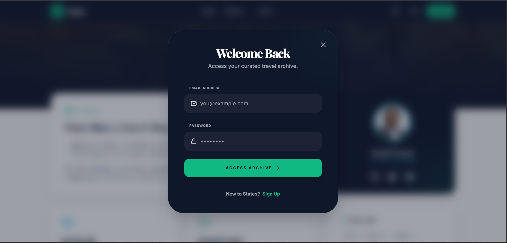

# State Stories

State Stories is a full-stack editorial application for discovering travel, culture, and heritage stories from Indian states. It brings the story archive, keyword search, reader comments, and account features into one responsive web experience.

**Live application:** [state-stories.vercel.app](https://state-stories.vercel.app/) · **API health:** [state-stories-api.vercel.app/api/health](https://state-stories-api.vercel.app/api/health) · **Source:** [github.com/coolkunal9/state-stories](https://github.com/coolkunal9/state-stories)

The application and health endpoint were reachable during the portfolio review. The health endpoint reported a connected database.



## Problem and project goals

Travel information about a state is often spread across separate articles and tourism pages. This project provides a single editorial archive where readers can explore state stories, search the collection, and discuss an article. Official tourism links are included on article pages as a starting point for trip planning.

## Features

- Responsive home page, state archive, article pages, and about page
- Server-side search across article title, state, and content
- Paginated article API with optional search and state filtering
- Reader registration and login, protected profile page, and comment history
- Authenticated comments attached to an article and user
- Dark mode, route-aware navigation, article sharing, and read-time estimates
- Loading and error states on the archive and search pages
- API validation, security headers, authentication rate limits, and centralized error responses

## Technology

| Area | Stack |
|---|---|
| Client | React 19, React Router 7, Tailwind CSS 3, Framer Motion, Lucide React |
| API | Node.js, Express 5, Joi validation, bcryptjs, JSON Web Tokens |
| Data | MongoDB Atlas or local MongoDB, Mongoose |
| Testing | Jest, Supertest, MongoMemoryServer |
| Hosting | Vercel client and API projects |

## Authentication and API flow

1. The client sends registration and login details to `POST /api/auth/register` and `POST /api/auth/login`.
2. Joi validates the request. The API hashes passwords with bcryptjs and signs a seven-day JWT.
3. The browser stores the token in `localStorage`. The shared API helper sends it as a `Bearer` token for protected requests.
4. On reload, the client checks the session through `GET /api/auth/me`. The profile and comment routes require a valid token.
5. A reader posts a comment through `POST /api/articles/:name/comments`; the API associates it with the authenticated user and article.

The JWT is stored in browser `localStorage`, so it is accessible to JavaScript running on the site. There is no refresh-token or server-side session-revocation flow. These are useful follow-up improvements for a production authentication system.

### API routes

| Method | Route | Purpose |
|---|---|---|
| `GET` | `/api/health` | Report API and database status |
| `GET` | `/api/articles?page=1&limit=12` | List articles with pagination |
| `GET` | `/api/articles?search=kerala` | Search titles, states, and content |
| `GET` | `/api/articles/:slug` | Read one article and its comments |
| `POST` | `/api/articles/:slug/comments` | Add a comment (JWT required) |
| `POST` | `/api/auth/register` | Create an account |
| `POST` | `/api/auth/login` | Authenticate an account |
| `GET` | `/api/auth/me` | Read the current profile (JWT required) |
| `GET` | `/api/auth/my-comments` | Read the current user's comments (JWT required) |

## Architecture

```text
client/                  React single-page application
├── src/components/      Navigation, auth, comments, and shared UI
├── src/context/         Authentication state and actions
├── src/pages/           Home, archive, search, article, profile, about
├── src/services/api.js  Fetch wrapper and bearer-token header
└── vercel.json          SPA route fallback

server/                  Express API and serverless entry point
├── middleware/          JWT auth, Joi validation, error handling
├── models/              User, Article, and Comment schemas
├── routes/              Auth and article HTTP routes
├── services/            Authentication and article data operations
├── tests/               Jest + Supertest API integration tests
├── db.js                Cached Mongoose connection
└── vercel.json          Serverless API routing
```

The client and API are separate Vercel projects rooted at `client/` and `server/`. The server reuses its Mongoose connection between serverless invocations. During local development, the client calls the API at `http://localhost:8000/api`.

## Run locally

Requirements: Node.js 20.19 or newer, npm, and a local MongoDB instance or MongoDB Atlas database. Mongoose 9, used by the API, requires Node.js 20.19 or newer.

```bash
git clone https://github.com/coolkunal9/state-stories.git
cd state-stories
npm install
npm install --prefix client
cp server/.env.example server/.env
cp client/.env.example client/.env
```

Set `MONGO_URI` and a private `JWT_SECRET` in `server/.env`. Keep the client API URL as `http://localhost:8000/api` in `client/.env` for local development. Do not commit either `.env` file.

To seed the configured database and start both applications:

```bash
npm run seed
npm run dev
```

The client runs at `http://localhost:3000`; the API runs at `http://localhost:8000`. The seed command upserts the sample articles in the database configured by `server/.env`; use only a development database.

Other useful commands from the repository root:

```bash
npm start                 # Start API
npm run client            # Start client
npm test                  # Run API integration tests
```

The client also supports `npm run build --prefix client` to create its production build.

## Known gaps and follow-up work

- The public application is an editorial demo; there is no content-management interface or working newsletter subscription.
- Some seeded articles refer to image files that are not present in `client/public/images/`. The client now shows a fallback image for those cards and article headers.
- `localStorage` token storage and per-instance rate limits are trade-offs; production use would benefit from a reviewed session design and shared rate-limit storage.
- The CORS middleware accepts Vercel preview origins by suffix. Confirm the intended preview policy and tighten it if only specific projects should call the API.
- The auth and search dialogs could use a full keyboard and screen-reader audit, including focus trapping and focus restoration.

## License

ISC. See `package.json`.
